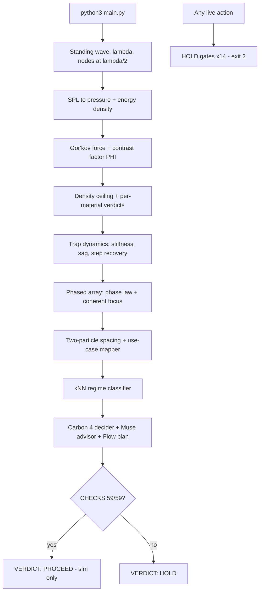
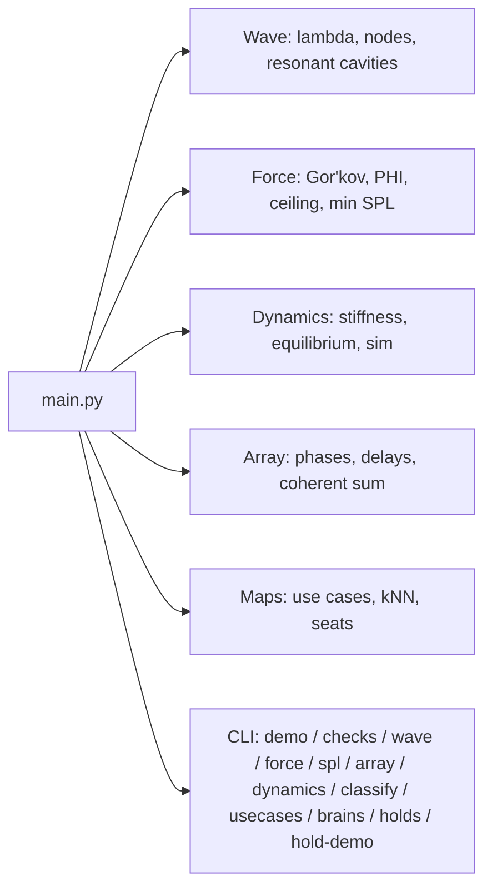
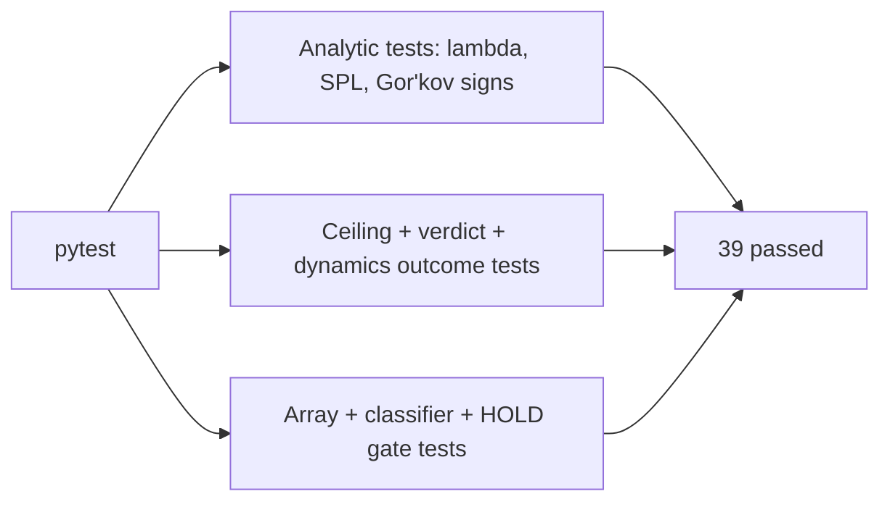
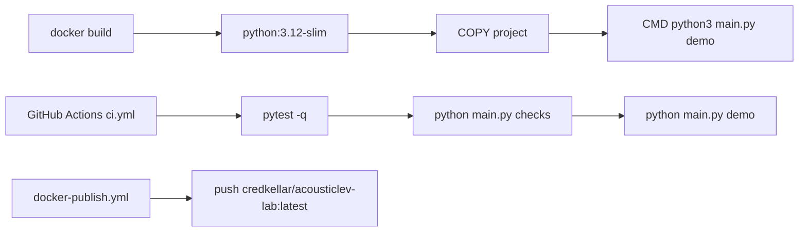
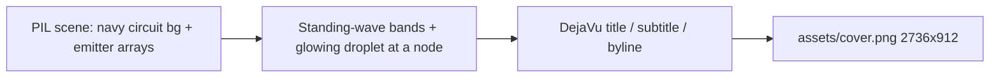

# 🔊 AcousticLev-Lab — Acoustic Levitation Sound Lab

> **A SIM-ONLY acoustic levitation lab in pure Python stdlib: the third levitation family — sound. Standing waves with λ/2 node spacing at 40 kHz, the Gor'kov radiation force on a small sphere, the honest density ceiling (styrofoam and water droplets yes, glass marginal, steel no), SPL requirements in the ~150–160 dB class, single-axis vs phased-array traps, trap dynamics, a containerless-processing mapper, and 14 HOLD gates. Nothing here makes a sound.**
>
> 👨‍💻 By Darion Kellar · 📜 MIT License · 🐍 Pure stdlib · 🌐 Zero network


> ⚠️ The two workflow badges above are the live GitHub Actions badges for this repo. They switch on as soon as `ci.yml` and `docker-publish.yml` from the workflow paste pack are pasted into `.github/workflows/` (plural) — until then there are no workflow runs for them to report.

LevitationX covered the magnetic and superconducting families; this lab goes deep on the third: **sound**. A 40 kHz standing wave in air has pressure nodes every λ/2 = 4.287 mm, and the Gor'kov radiation force parks small particles at those nodes — no contact, no container, no strings. But the same math that makes it work also draws the line: force and weight both scale with particle volume, so the ceiling is on **density** — about 2,640 kg/m³ at 160 dB in this model. Styrofoam floats easily, water droplets need ≈156 dB, glass is marginal, and steel is honestly out of reach. This lab computes all of that from the Gor'kov potential, proves the trap is restoring by the sign of the force on both sides of a node, and keeps every live action behind 14 HOLD gates that nothing — including the AI seats — can lift.

---

## 🧰 Tech Stack Badges & Full Architecture Tech Stack

### 💻 Core Programming Languages & Core Systems


-brightgreen)


**🧠 Advisory seats (names-only, never override a HOLD):**


-34A853)

ONE `main.py` holds the standing-wave geometry, SPL conversions, the Gor'kov force model, the density-ceiling analysis, trap dynamics, the phased-array phase law, the use-case mapper, the classifier and the seats — the whole lab can be read, run and audited in one sitting.

### ⛓️ Web3 & Infrastructure

None — honestly none. AcousticLev-Lab runs fully offline in one file; there is no chain, no token, and no wallet involved (and `investment_claim` is a HOLD gate).

### ⚙️ Platform Support & Hardware Architecture


Pure Python — it runs anywhere Python 3 runs (developed and verified on Linux). It drives **no hardware at all**: no transducers, amplifiers or emitters are controlled, ever — that is what the `real_hardware_control` HOLD gate means.

### ⚡ Low-Level Infrastructure & Performance


No compiled or low-level code — the honest performance story is the sim itself: fixed-step deterministic dynamics (semi-implicit Euler, dt = 0.1 ms, summed analytic forces, zero randomness) whose output is byte-identical on a double run, with every headline number asserted in CHECKS.

### 🛠️ DevOps & Build Tools


`ci.yml` (checkout → Python 3.12 → `pytest -q` → `python main.py checks` → `python main.py demo`) and `docker-publish.yml` (build + push `credkellar/acousticlev-lab:latest`) are delivered in the workflow paste pack and are pasted into `.github/workflows/` by the repo owner, with that repo's own `DOCKERHUB_USERNAME` / `DOCKERHUB_TOKEN` secrets.

### ☁️ Cloud Providers

None — honestly none. There is no cloud call, no account, and no API key involved; the advisory seats are names-only seats in code, not live calls.

---

## What this does?

1. 🌊 **Builds the standing wave** — at 40 kHz in air (c = 343 m/s), λ = 8.575 mm, so pressure nodes sit at odd multiples of λ/4 (2.144, 6.431, 10.719, … mm) and repeat every λ/2 = 4.287 mm; resonant transducer–reflector cavities are exactly n·λ/2 long, and 23 node planes fit in 10 cm.
2. 🔊 **Converts SPL to pressure honestly** — p_rms = 20 µPa × 10^(SPL/20): 160 dB is 2,000 Pa RMS at an antinode, energy density 14.17 J/m³. 40 kHz is ultrasonic (you can't hear the pitch) — the lab says plainly that the *intensity* is still extreme, which is why live exposure is HOLD-gated.
3. 🎯 **Computes the Gor'kov force** — F(z) = 4πa³kE_ac·Φ·sin(2kz), with Φ = f₁/3 + f₂/2 built from the particle's density and compressibility. Φ ≈ 0.83 for water, glass and steel alike; Φ ≈ 0.80 for styrofoam.
4. ✅ **Proves the trap** — the force is zero at nodes and antinodes, maximal at λ/8, and *restoring*: positive just below a node, negative just above it (for Φ > 0). The sign analysis is asserted in CHECKS, not just drawn.
5. ⚖️ **Draws the honest ceiling** — levitation needs max|F| ≥ mg; both scale with volume, so radius cancels and the ceiling is a **density**: ≈2,640 kg/m³ at 160 dB. Verdicts at 1 mm: styrofoam levitates, water levitates, glass marginal, aluminum no, steel no.
6. 📈 **Prices each material in dB** — minimum SPL from the same model: styrofoam ≈139.9 dB, water ≈155.8 dB, glass ≈159.8 dB, steel ≈164.7 dB. That is *why* real levitators live in the ~150–160 dB class — and why +5 dB only multiplies the ceiling by √10.
7. 🎢 **Simulates the trapped particle** — trap stiffness from the Gor'kov curvature (0.163 N/m for a 1 mm water droplet), oscillation at 31.0 Hz, gravity sagging the equilibrium 0.265 mm below the node, and a +0.5 mm step disturbance that recovers bounded and settled in the deterministic sim.
8. 📡 **Contrasts single-axis with phased array** — the classic levitator is one axis (source + reflector, the N = 2 case). The phased array focuses by phase law φᵢ = −k·rᵢ: 8 emitters sum to exactly N = 8 at the focus (pressure gain ×8, intensity ×64) vs 2.55 unfocused — and the delay law τᵢ = (r_max − rᵢ)/c is computed per emitter.
9. 💧💧 **Places two particles** — adjacent node planes hold two droplets exactly λ/2 = 4.287 mm apart. Spacing only: the lab makes no interaction claim beyond the shared wave geometry.
10. 🧪 **Maps containerless processing** — five educational use cases (droplet chemistry, pharmaceutical research, materials undercooling, protein crystallography, alloy solidification) with the honest reason each wants no wall contact — and a HOLD gate on every production or medical reading.
11. 🧠 **Classifies the regime** — a stdlib kNN labels (density, radius, SPL) as levitates / marginal / too-dense-or-big, agreeing with the Gor'kov verdicts on all five canonical cases (96.3% self-accuracy on its training set).
12. 🪑 **Consults the seats and runs CHECKS** — Carbon 4 decides (MAP→MODEL→STRESS→DECIDE, tighten-only, sha256 trace), Muse advises (can_override_hold = False), Flow plans 4 shots (rendered = False, live = 0); then 59 assertions print the VERDICT.

---

## 📊 Mermaid flowchart diagram per script

### 🗺️ Master flow



### 📜 main.py — the whole lab



### 🧪 tests/test_main.py — verification



### 🐳 Dockerfile + CI flow



### 🎨 assets/cover.png — the cover



---

## Why is this cool?

1. 🔊 It completes the levitation trilogy — LevitationX did magnets and superconductors; this is the family that floats things on *sound you cannot hear*.
2. 🎯 The trap is proven, not pictured: the force's sign flips exactly at the node, and CHECKS assert the restoring direction on both sides.
3. ⚖️ The density ceiling is a beautiful piece of physics — force and weight both scale with volume, so size cancels and only density matters.
4. 🥤 It floats the demo classic and drowns the hype in the same table: styrofoam at ≈140 dB, steel needing ≈165 dB — arithmetic, not adjectives.
5. 💧 A water droplet hangs 0.265 mm *below* its node because gravity sags the trap — the lab computes the sag instead of hiding it.
6. 🎢 The trapped droplet is a tiny oscillator with a real frequency: 31 Hz for 1 mm of water, straight from the curvature of the Gor'kov potential.
7. 📡 Phased-array focusing is shown as pure arithmetic: set φᵢ = −k·rᵢ and 8 emitters sum to exactly 8 — phase *is* the steering wheel.
8. 🧪 Containerless processing is real science (wall-free droplets for chemistry and crystallography) — mapped educationally, with every production claim HOLD-gated.
9. 🎯 Deterministic end to end: run it twice, get byte-identical output — acoustics you can diff.
10. 🔒 The safety story is honest about sound itself: "ultrasonic" means inaudible pitch, not harmless — exposure, weaponization and "silent operation" claims are all permanent HOLD gates.

## What problems this solves?

1. ❌ **Problem:** Acoustic levitation videos look like anti-gravity magic. ✅ **Solution:** The Gor'kov force is computed in the open, and it only exists inside a driven standing wave — turn the sound off and the "magic" is zero.
2. ❌ **Problem:** "It levitates!" claims never say *what*. ✅ **Solution:** The density ceiling (≈2,640 kg/m³ at 160 dB) names exactly what floats and what cannot, per material, with margins.
3. ❌ **Problem:** Bigger-particle claims ignore regime limits. ✅ **Solution:** The verdict logic checks diameter against λ as well as density against the ceiling — a 4 mm water sphere at 160 dB is graded too-dense-or-big, not levitates.
4. ❌ **Problem:** SPL numbers get quoted without meaning. ✅ **Solution:** Every dB figure is converted to pascals and J/m³, and each material's minimum SPL falls out of the force balance itself.
5. ❌ **Problem:** "Ultrasonic = silent = safe" marketing. ✅ **Solution:** The lab states the intensity plainly, refuses the silent-operation claim by HOLD gate, and gates all live exposure.
6. ❌ **Problem:** Trap stability is usually hand-waved. ✅ **Solution:** Sign analysis at the node, a stiffness in N/m, an oscillation frequency, and a step-disturbance sim that must recover bounded — all asserted.
7. ❌ **Problem:** Phased arrays sound like science fiction. ✅ **Solution:** The phase and delay laws are eight lines of arithmetic whose coherent sum is checked to equal N exactly.
8. ❌ **Problem:** Two-particle demos imply controlled interaction. ✅ **Solution:** The lab claims spacing (λ/2) and nothing more — secondary interaction forces are declared out of scope.
9. ❌ **Problem:** Containerless-processing hype skips the "research only" part. ✅ **Solution:** Each use case carries its reason *and* its HOLD gate (industrial process / medical / guaranteed performance).
10. ❌ **Problem:** Simulation tools quietly imply a product. ✅ **Solution:** Commercial, medical, people-levitation and guaranteed-performance claims are permanent HOLD gates, and every number is labelled model or sim.

---

## How to install this?

1. 🐍 Make sure you have **Python 3.10+** (built and verified on 3.12).
2. 📥 Clone or download this repo and open a terminal in its folder.
3. ▶️ Run the lab:
   ```bash
   python3 main.py
   ```
   You should see the 11-section demo, **CHECKS: 59/59**, **VERDICT: PROCEED**.
4. 🛑 Try a HOLD gate:
   ```bash
   python3 main.py hold-demo
   ```
   Expected: `HOLD: levitate_living_tissue_live` and exit code 2.
5. 🎛️ Try the other commands:
   ```bash
   python3 main.py checks     # the 59 built-in checks only
   python3 main.py wave       # standing-wave geometry, as data
   python3 main.py force      # Gor'kov force vs weight per material
   python3 main.py spl        # density ceilings + verdicts, as data
   python3 main.py array      # phased-array phases, delays, gains
   python3 main.py dynamics   # trap step-recovery sim, as data
   python3 main.py classify   # levitates / marginal / too-dense-or-big examples
   python3 main.py usecases   # containerless processing map
   python3 main.py brains     # Carbon 4 + Muse + Flow seats
   python3 main.py holds      # all 14 HOLD gates
   ```
6. 🧪 (Optional) Run the test suite:
   ```bash
   pip install pytest
   pytest -q
   ```
   Expected: **39 passed**.
7. 🐳 (Optional) Run it in Docker:
   ```bash
   docker build -t credkellar/acousticlev-lab:latest .
   docker run --rm credkellar/acousticlev-lab:latest
   ```

---

## Requirements

- 🐍 Python 3.10+ (built and verified on 3.12) — pure standard library
- 📦 Zero third-party packages for the lab itself
- 🧪 pytest only if you want to run the test suite
- 🐳 Docker only if you want the container route
- 🚫 No network, no accounts, no API keys — the advisory seats are names-only seats in code, not live calls

---

## FULL project structure tree

```
acousticlev-lab/
├── main.py                  # 🎛️ the whole lab: standing wave, SPL, Gor'kov force, density ceiling, trap dynamics, phased array, use-case mapper, kNN, seats, HOLD gates, CHECKS
├── tests/
│   └── test_main.py         # 🧪 39 pytest tests against analytic values and sim outcomes
├── conftest.py              # 🧭 puts the repo root on sys.path for bare pytest
├── Dockerfile               # 🐳 python:3.12-slim, runs the demo
├── assets/
│   └── cover.png            # 🎨 2736x912 cover — upload this file to the repo assets/ folder
└── README.md                # 📖 this file
```

*Workflow files (`ci.yml`, `docker-publish.yml`) and the Docker Hub pack are delivered separately as paste packs — they are pasted into `.github/workflows/` (plural) by the repo owner, with that repo's own `DOCKERHUB_USERNAME` / `DOCKERHUB_TOKEN` secrets.*

---

## 🛑 The HOLD list — 14 gates

| Gate | Rule |
|---|---|
| live_hazardous_material_levitation | No live levitation of any hazardous material |
| real_hardware_control | No transducers, amplifiers, or hardware are driven |
| levitate_living_tissue_live | No levitating living tissue, organisms, or animals, live |
| high_spl_exposure_live | No live high-SPL exposure of people or animals |
| bypass_spl_limits | SPL safety limits cannot be bypassed or widened |
| commercial_product_claim | Never claim this sim is a product or product design |
| medical_claim | No medical, pharmaceutical-production, or therapeutic claims |
| claim_silent_operation | No "silent" claims — levitation-class fields are intense ultrasound |
| weapons_application_claim | No weapons application claims of any kind |
| investment_claim | No investment, token, or returns claims |
| ultrasonic_weaponization | No weaponizing ultrasound: no pain, harm, or crowd-control use |
| levitate_people_claim | No levitating a person — the force/density math forbids it at safe SPL |
| industrial_process_claim | Never claim this sim is an industrial or production process |
| guaranteed_performance_claim | No guaranteed levitation performance for any real rig |

**🪑 Council seats:** Gemini Carbon 4 — DECIDER (MAP→MODEL→STRESS→DECIDE, tighten-only, sha256 trace) · Muse — advisor (`can_override_hold = False`) · Google Flow — planner (plan-only, rendered = False, live = 0).

**✅ Verification:** pytest **39 passed** · CHECKS **59/59** · VERDICT: PROCEED (sim only) · double-run byte-identical · `hold-demo` exits 2.

---

## 🧒 In plain English (5th grade)

Some sounds are too high for your ears to hear, but they can still push on things. If you aim that sound just right, it makes invisible "shelves" in the air, one above the other. A tiny bead or a drop of water can sit on one of those shelves and float — no strings, no magnets, nothing touching it.

But the shelves are not very strong. Light things like foam beads float easily. Water drops can float too, but only if the sound is super, super strong — much stronger than any sound you would ever want near your ears. Heavy things like steel balls cannot float this way at all, and this project shows the math that proves it. The sound also has to keep playing the whole time: turn it off, and everything falls.

This project is a pretend sound-floating lab inside a computer. It does not make any real sound, and it will never float a person — the numbers say that is not possible. It just helps you learn how floating on sound really works.

---

📜 MIT License © 2026 Darion Kellar — AcousticLev-Lab is an educational simulation lab. It is not a product, not a levitation manual, and not affiliated with any acoustic-levitation manufacturer.
